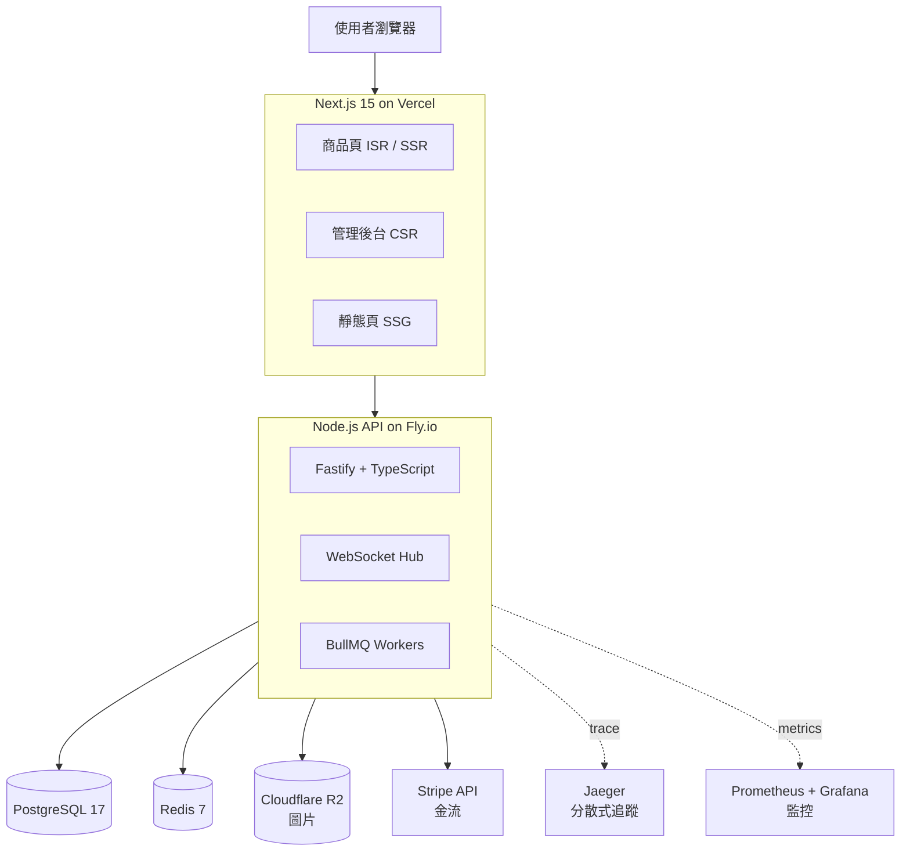

# Orderly

> A full-stack e-commerce platform built to demonstrate production-grade
> backend architecture: Saga pattern, idempotency, distributed tracing,
> horizontal scaling preparation—implemented in a **Next.js + Node.js monorepo**.

🔗 **Live Demo**: (coming soon)
📺 **Video Walkthrough**: (coming soon)

---

## 為什麼做這個？

這個專案是我從前端工程師轉全端的學習成果——聚焦在
「真實 production 系統會遇到的問題」，不是 todo-list demo。

**重點展示**：

- 🔒 高並發下單不超賣（SELECT FOR UPDATE + Idempotency Key）
- 🔄 跨服務一致性（Saga Pattern + Outbox）
- 📊 可觀測性（Structured log + Prometheus + Jaeger）
- 📈 水平擴展準備（Stateless API + Redis session）
- 🧪 完整 CI/CD（test → build → deploy）
- 🎯 全端整合（CORS、Auth、WebSocket、檔案上傳）

**作者視角**：作為 QNAP 前端工程師（QuMagie），我要證明的不是「我會寫 code」，
而是「我能做出 production-ready 系統、並且解釋每個決策背後的 trade-off」。

---

## 架構圖



---

## 技術棧

### Frontend

| 分類 | 選擇 | 理由 |
|------|------|-----|
| Framework | **Next.js 15** (App Router) | SSR + CSR 混合、SEO 友善 |
| 語言 | TypeScript strict | 和 backend 共用型別 |
| 樣式 | Tailwind CSS | 開發速度快 |
| 部署 | Vercel | Next.js 原生整合 |

### Backend

| 分類 | 選擇 | 理由（詳見 ADR-0003） |
|------|------|---------------------|
| Runtime | **Node.js 20 + TypeScript** | 全端同語言、shared code |
| Framework | **Fastify** | 比 Express 快 2-3 倍、TS 原生 |
| DB 存取 | **pg + pgtyped** | Type-safe raw SQL（不走 ORM） |
| Validation | **Zod** | Schema 與型別雙向生成 |
| 測試 | **Jest** | 生態系大、資源豐富 |
| HTTP Client | **axios** | API 熟悉、攔截器方便 |
| WebSocket | **ws** | 輕量、原生 |
| Task Queue | **BullMQ** + Redis | Node.js 標配 |
| 部署 | Fly.io 或 Railway | 免費額度足 |

### 資料與基礎設施

| 分類 | 選擇 |
|------|------|
| 主資料庫 | PostgreSQL 17 |
| 快取 / Session | Redis 7 |
| 訊息佇列 | RabbitMQ |
| 檔案儲存 | Cloudflare R2 (S3 相容、免費) |
| 金流 | Stripe (測試模式) |
| 監控 | Prometheus + Grafana + Jaeger |
| CI/CD | GitHub Actions |

### 開發工具

| 分類 | 選擇 |
|------|------|
| Monorepo | pnpm workspaces |
| Linter / Formatter | ESLint + Prettier |
| Package Manager | pnpm 9+ |

---

## 核心功能（開發中）

### 使用者端

- [ ] 註冊 / 登入 / JWT
- [ ] 商品瀏覽 + 搜尋
- [ ] 購物車
- [ ] 下單 + Stripe 金流
- [ ] 即時訂單狀態通知（WebSocket）
- [ ] 訂單歷史 / 退款

### 管理端

- [ ] 商品 CRUD + 圖片上傳
- [ ] 訂單管理 + 出貨
- [ ] 營運 Dashboard

---

## 專案結構
orderly/
├── apps/
│ ├── api/ # Node.js backend (Fastify + pg + pgtyped)
│ └── web/ # Next.js frontend
├── packages/
│ └── shared-types/ # TypeScript types shared between apps
├── archive/
│ └── go-api/ # 原 Go 實作，不再演化（學習對照用）
├── docs/
│ ├── architecture.md
│ └── adr/ # Architecture Decision Records
├── docker-compose.yml # Local development
├── .github/workflows/ # CI/CD
├── package.json # Root workspace
└── pnpm-workspace.yaml

---

## 架構決策記錄（ADR）

每個重要決策都有文件：

- [ADR-0001: 使用 Monorepo](./docs/adr/0001-use-monorepo.md)
- [ADR-0002: 從 Go 換成 Node.js](./docs/adr/0002-nodejs-instead-of-go.md)
- [ADR-0003: Node.js Backend 技術棧選型](./docs/adr/0003-nodejs-backend-stack.md)

> 💡 **為什麼看 ADR**：每個決策有 Context（當時狀況）、考慮過的方案、
> 做了什麼選擇、為什麼、以及 Review Date（何時重新評估）。
> 這是我從 Phase 5 開始採用的 senior 工程習慣。

---

## 在本機跑起來

### 需求

- Node.js ≥ 20
- pnpm ≥ 9
- Docker + Docker Compose
- PostgreSQL 17（透過 Docker 跑）

### 步驟

```bash
# 1. Clone
git clone git@github.com:yourname/orderly.git
cd orderly

# 2. 複製環境變數範本、填入真實值
cp .env.example .env
# 編輯 .env：填入 Stripe test key、R2 credentials 等

# 3. 安裝依賴
pnpm install

# 4. 啟動本機服務（Docker）
docker-compose up -d

# 5. 跑 migration
pnpm --filter api migrate

# 6. 啟動 dev server
pnpm dev     # (待實作) 一鍵啟動 api + web
# 或分別：
pnpm dev:api    # http://localhost:8080
pnpm dev:web    # http://localhost:3000
```

---

## 學習歷程與里程碑

**這個專案是 2026 年全端轉職計畫的成果**。4 個月分階段完成：

### ✅ Phase 1-4（已完成，Go 版本）

- Phase 1: HTTP / Express 基礎
- Phase 2: Go 語言入門
- Phase 3: 訂單系統從零到可 production
- Phase 4: DB 進階（索引、N+1、Isolation、Pool、Migration、Normalization）

**產出**：`archive/go-api/`——完整可跑的 Go 訂單系統。

### ✅ Phase 5 L1-L4（已完成）

- L1: Redis Cache（cache-aside、TTL、失效策略）
- L2: Message Queue（Kafka vs RabbitMQ vs Redis Streams）
- L3: Load Balancer + 水平擴展（L4/L7、Session、部署策略）
- L4: API Design（REST/GraphQL/gRPC、Idempotency Key、分頁）

### 🚧 Phase 4.5（進行中，Node.js 補強）

決定全端轉向後、把 backend 遷移到 Node.js。這 4 課補齊 Node.js server-side 基礎：

- [ ] L1: Node.js Runtime + Module 系統
- [ ] L2: Fastify + TypeScript 架構
- [ ] L3: pg + pgtyped + PostgreSQL
- [ ] L4: Zod + 錯誤處理模式

### ⏳ Phase 5 L6-L8（接下來）

- L6: 資料一致性（CAP + Saga Pattern）
- L7: Observability（log / metric / trace）
- L8: 韌性設計（Rate limit、Circuit breaker、Retry）

### ⏳ Phase 6: DevOps（4 課）

Docker 深入、Docker Compose、CI/CD、雲端部署

### ⏳ Phase 6.5: 全端整合（3 課）

API 整合實務、即時通訊、全端架構決策

### ⏳ Phase 7: 面試準備（4 課）

系統設計、經典題拆解、Coding、行為面試

### ⏳ Phase 8: 進階選修（3 課）

Testing、資安、錯誤處理與日誌

---

## 作者

**Paul (張品義)**

- 目前：QNAP 前端工程師（QuMagie 相片管理、臉部辨識）
- 進修：北教大資工在職專班
- 這個專案：從前端工程師轉全端的學習歷程 + 作品集

📧 [你的 email]
🔗 [你的 GitHub]
💼 [你的 LinkedIn]
